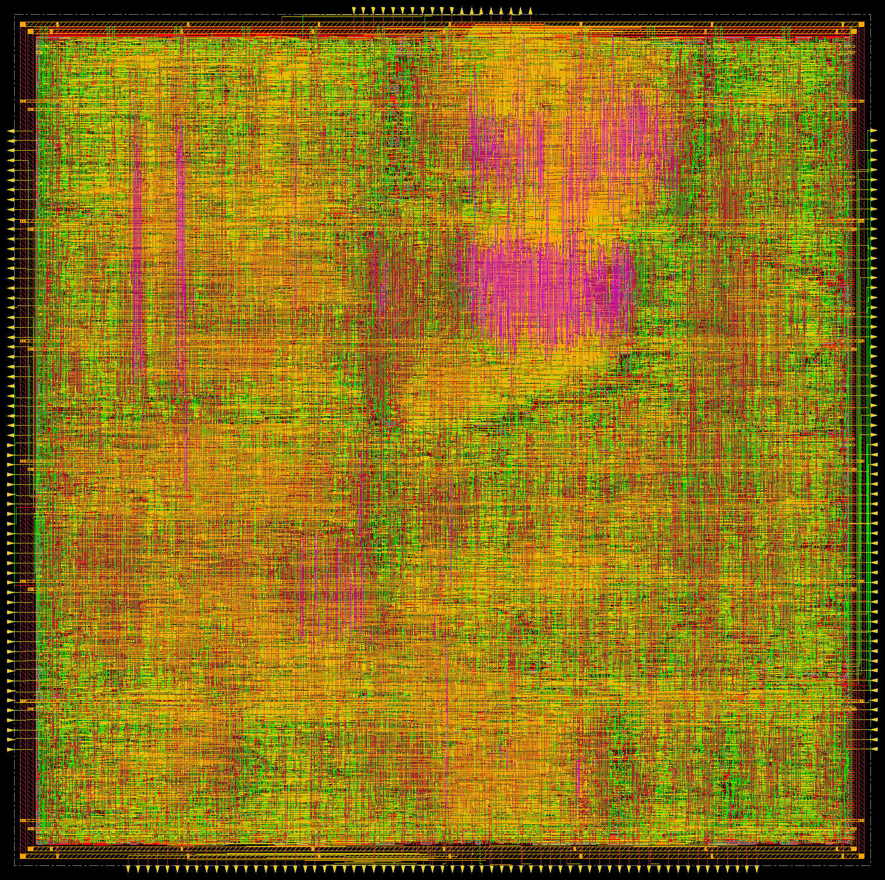
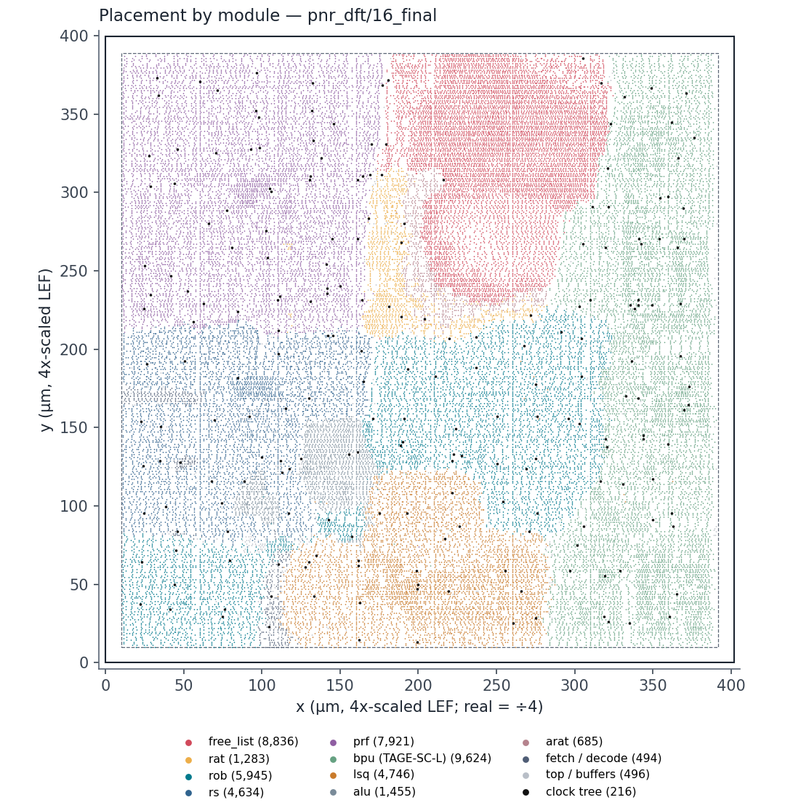
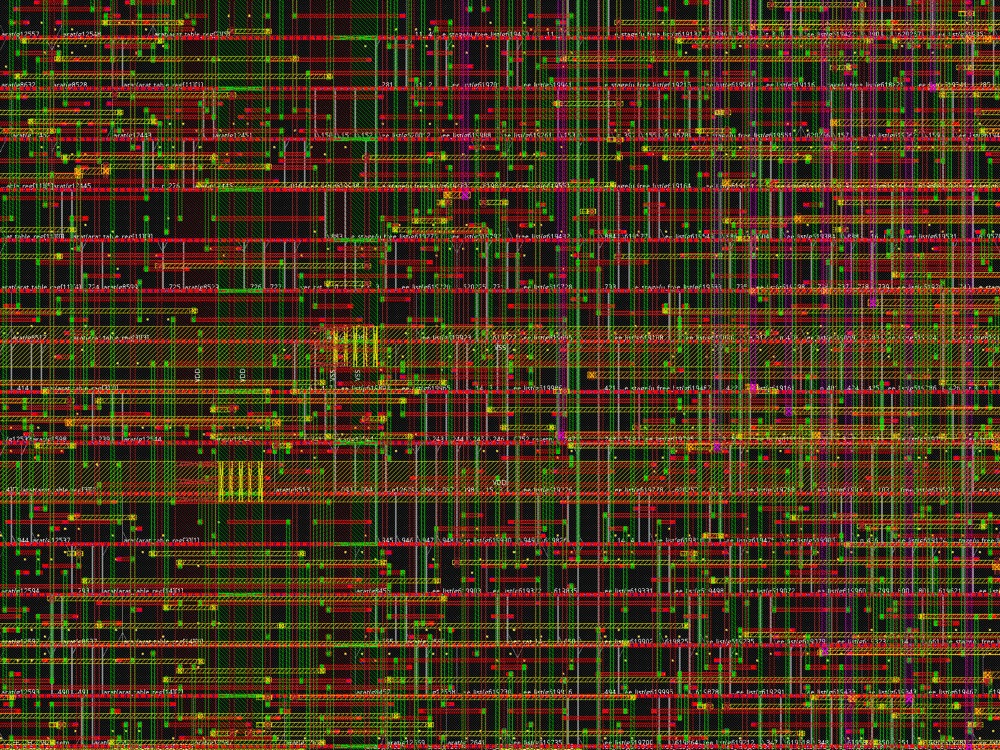
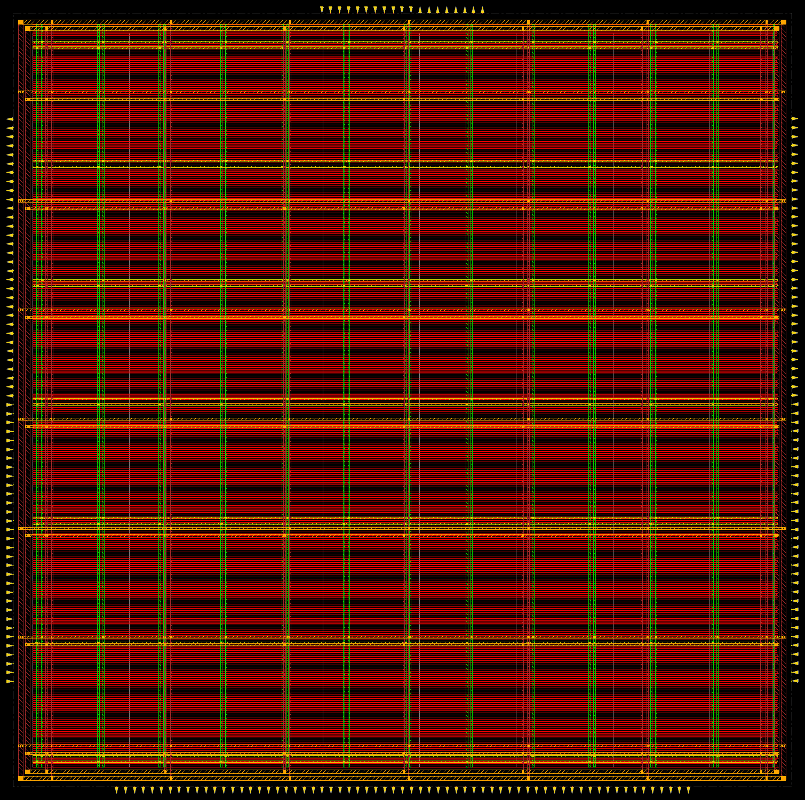
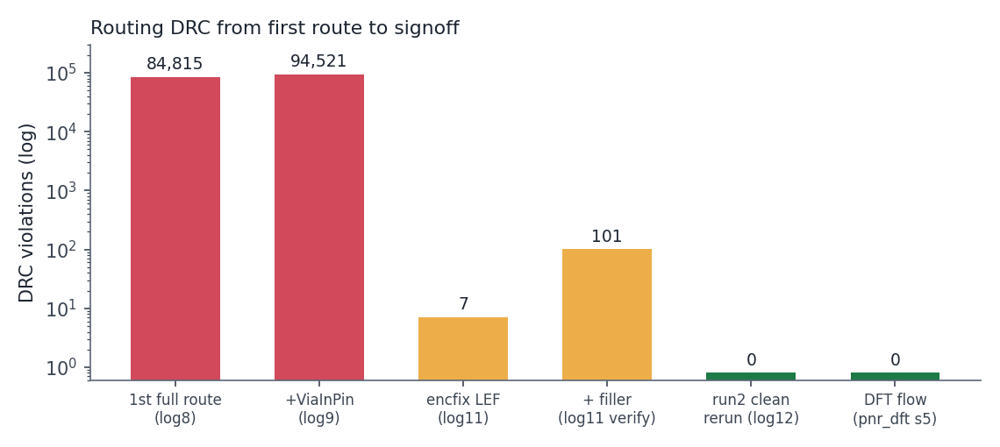
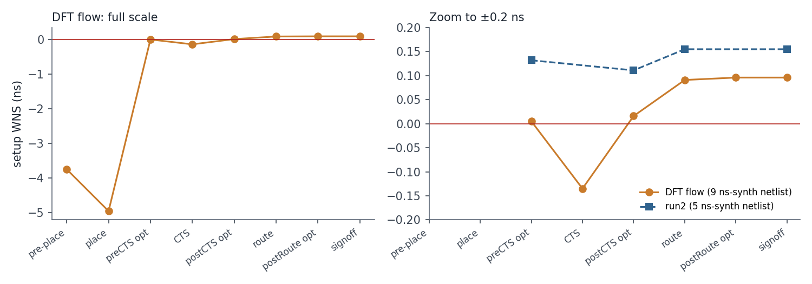
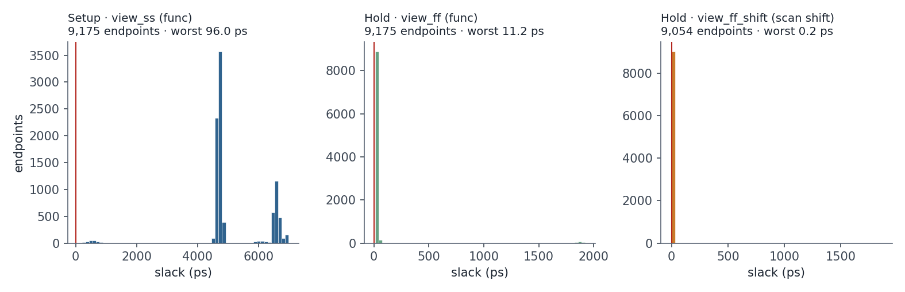
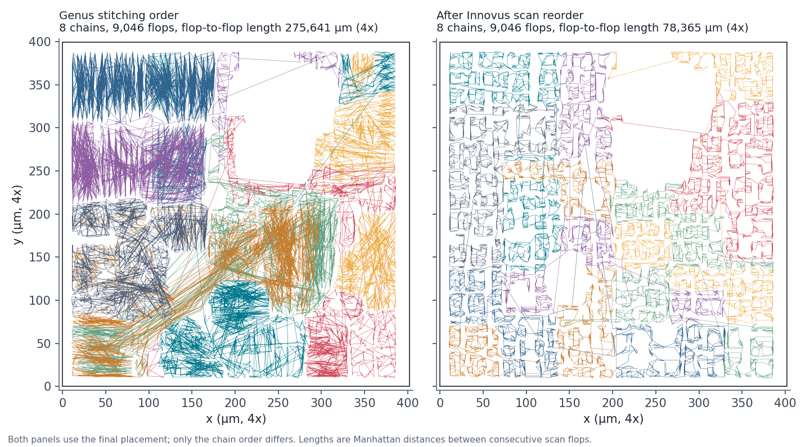

# RISC-V (RV32I) Out-of-Order CPU with TAGE-SC-L Branch Predictor

A superscalar-capable out-of-order RISC-V core featuring a three-tier **TAGE-SC-L** branch
predictor (TAGE + Loop Predictor + Statistical Corrector), taken from RTL to signoff on the
**ASAP7 7 nm** predictive PDK with **full-scan DFT**.

The project covers the complete digital design flow: RTL design → functional verification →
logic synthesis → scan insertion → formal equivalence checking → multi-mode, multi-corner
place-and-route with scan reordering → timing closure → DRC-clean signoff.

---

## Key Results

| | Result |
|---|---|
| **Branch accuracy** | **96.5%**|
| **MPKI** | **11.9** (vs. 281.8 with no predictor) — **95.8% reduction** |
| **Active IPC** | **0.492** (vs. 0.358) — **+37.4%** |
| **Operating frequency** | **111 MHz** (9 ns), signed off at SS 0.63 V / 100 °C with ±5% OCV |
| **Setup / hold WNS** | **+96 ps / ≥ 0** across SS, TT, FF and scan-shift modes |
| **Die area** | **0.0100 mm²** (≈ 100 × 100 µm) |
| **Total power** | **2.17 mW** @ 0.7 V (TT, 25 °C) |
| **Scan** | **8 chains**, 9,046 scan flops, 0 DFT rule violations |
| **DRC violations** | **0** |
| **Formal equivalence** | **PASS** — RTL → scan netlist → post-route netlist |
| **Functional verification** | **75/75 checks PASS** across 14 directed tests |

**Technology:** ASAP7 asap7sc7p5t_28 (7 nm predictive PDK; RVT / LVT / SLVT)

**Tools:** Cadence Genus 25.1, Cadence Innovus 25.1, Cadence Conformal LEC 25.2, ModelSim



---

## Table of Contents

1. [Microarchitecture](#1-microarchitecture)
2. [TAGE-SC-L Branch Predictor](#2-tage-sc-l-branch-predictor)
3. [Branch Prediction Results](#3-branch-prediction-results)
4. [Physical Design](#4-physical-design)
5. [Timing Closure](#5-timing-closure)
6. [Verification](#6-verification)
7. [Design for Test (Scan)](#7-design-for-test-scan)
8. [Repository Structure](#8-repository-structure)

---

## 1. Microarchitecture

Classic Tomasulo-style out-of-order execution with a reorder buffer for precise exceptions
and branch recovery.


### Parameters

| Structure | Configuration |
|---|---|
| Reorder Buffer (ROB) | 16 entries |
| Reservation Station (RS) | 8 entries |
| Load-Store Queue (LSQ) | 8 entries, with store-to-load forwarding |
| Physical Register File | 64 registers (6-bit physical tags) |
| Architectural registers | 32 (RV32I) |
| Rename | RAT + Free-List, ARAT-based recovery on mispredict |
| Memory interface | Chip-level ports (external instruction/data memory) |

### Verified ISA Subset

| Class | Instructions |
|---|---|
| R-type | `ADD` `SUB` `AND` `OR` `XOR` `SLL` `SRL` `SRA` `SLT` `SLTU` |
| I-type | `ADDI` `ANDI` `SLTI` `SLTIU` |
| Branch | `BEQ` `BNE` `BLT` `BGE` `BLTU` `BGEU` |
| Jump | `JAL` `JALR` |
| Upper-imm | `LUI` `AUIPC` |
| Memory | `LW` `SW` |

---

## 2. TAGE-SC-L Branch Predictor

Three cooperating predictors, following Seznec's TAGE-SC-L design. Each component targets a
different class of branch behaviour, and they are combined by a confidence-gated override
policy.

### 2.1 TAGE — Geometric History Length Tables

| Table | Entries | History length | Tag width | Counter |
|---|---|---|---|---|
| **T0** (bimodal) | 128 | — (PC only) | none | 2-bit unsigned |
| **T1** | 32 | 4 | 8-bit | 3-bit signed |
| **T2** | 32 | 16 | 10-bit | 3-bit signed |
| **T3** | 32 | 64 | 12-bit | 3-bit signed |

- **Provider selection** — the longest-history table whose tag matches supplies the
  prediction; the next-longest match becomes the *alternate* prediction, used to drive
  useful-bit updates.
- **Folded XOR indexing** — the 64-bit global history register is compressed to a 5-bit
  index and a 10/12-bit tag by segmenting and XOR-folding, so every history bit influences
  the lookup in a single cycle of pure XOR logic.
- **Independent index/tag hashing** — indices and tags fold different slices, so an index
  collision does not imply a tag collision. Tag widths scale with history length
  (8/10/12-bit for h = 4/16/64) because longer histories compress into the same 5-bit index
  space and therefore alias more.
- **Useful-bit replacement** — `u` measures how often an entry beat its alternate, not how
  often it was correct. Only `u == 0` entries may be reallocated, and an 8-bit aging counter
  halves all useful bits every 256 updates so stale entries are eventually reclaimed.

### 2.2 Loop Predictor (LP)

8 entries · 10-bit tag · 10-bit current/committed iteration counters · 2-bit confidence.

TAGE saturates on a long-running loop and therefore mispredicts every loop exit. The LP
counts iterations and predicts `taken` while `cur_iter < conf_iter`. It only overrides TAGE
after the same trip count has been observed twice (confidence ≥ 2), which prevents it from
interfering with irregular branches.

### 2.3 Statistical Corrector (SC)

Three 16-entry tables of 6-bit signed counters, indexed by three independent views:

| Table | Index | Captures |
|---|---|---|
| `sc_ghist` | `PC ^ GHR[3:0]` | correlation with recent branch outcomes |
| `sc_path` | `PC ^ PHR[3:0]` | correlation with the control-flow path taken |
| `sc_bias` | `PC` | the branch's intrinsic bias |

The three counters are sign-extended and summed — a hardware perceptron. SC overrides TAGE
only when **all three** conditions hold: TAGE's provider counter is weak, `|score| ≥ 8`, and
the two predictions disagree. Updates are error-driven (counters move only when the final
prediction was wrong), which keeps switching activity low.

### 2.4 Override Priority

```
if      (LP confidence ≥ 2)                        → use LP
else if (TAGE weak && SC strong && they disagree)  → use SC
else                                                → use TAGE
```

---

## 3. Branch Prediction Results

Three predictor configurations were built and run through the identical 14-test regression:

- **No BPU** — no branch predictor; fetch advances `PC + 4` unconditionally and relies on
  the ROB to flush and redirect. Since the regression is loop-dominated (~81% of branches
  taken), this is correct only on the ~19% that fall through.
- **TAGE** — 4-table geometric-history TAGE
- **TAGE-SC-L** — TAGE + Loop Predictor + Statistical Corrector

### 3.1 Aggregate Results

| Metric | No BPU | TAGE | **TAGE-SC-L** | No BPU → SC-L |
|---|---|---|---|---|
| Branch accuracy | 18.6% | 94.7% | **96.5%** | **+77.9 %** |
| MPKI | 281.8 | 18.1 | **11.9** | **−95.8%** |
| Mispredicts | 2,011 | 158 | **104** | **−94.8%** |
| Active IPC | 0.358 | 0.489 | **0.492** | **+37.4%** |
| Instructions retired | 7,134 | 8,684 | **8,684** | +21.7% |
| Active cycles | 19,873 | 17,723 | **17,615** | −11.4% |


### 3.2 Per-Test Breakdown

**Test 10 — 100-iteration loop** (99 T + 1 NT, tests warm-up behaviour)

| | No BPU | TAGE | TAGE-SC-L |
|---|---|---|---|
| Result | 1 P / 1 **F** | 2 P / 0 F | 2 P / 0 F |
| Accuracy | 0.8% | 98.0% | **98.0%** |
| MPKI | 390.7 | 7.6 | **7.6** |
| Mispredicts | 118 | 4 | **4** |
| IPC | 0.201 | 0.350 | **0.350** |

**Test 11 — Alternating pattern, period 2** (T, NT, T, NT …)

| | No BPU | TAGE | TAGE-SC-L |
|---|---|---|---|
| Result | 1 P / 3 **F** | 4 P / 0 F | 4 P / 0 F |
| Accuracy | 20.6% | 89.3% | **98.1%** |
| MPKI | 312.1 | 41.3 | **7.1** |
| Mispredicts | 407 | 64 | **11** |
| IPC | 0.260 | 0.339 | **0.347** |
| LP overrides | — | — | **293** |

**Test 12 — 4-cycle pattern, period 4** (NT NT NT T)

| | No BPU | TAGE | TAGE-SC-L |
|---|---|---|---|
| Result | 1 P / 3 **F** | 4 P / 0 F | 4 P / 0 F |
| Accuracy | 27.8% | 92.4% | 91.9% |
| MPKI | 299.3 | 31.1 | 33.5 |
| Mispredicts | 397 | 53 | 57 |
| LP / SC overrides | — | — | LP 64 / SC 5 |

**Test 13 — 16-cycle pattern, period 16** (exercises T2, h = 16)

| | No BPU | TAGE | TAGE-SC-L |
|---|---|---|---|
| Accuracy | 32.3% | 95.9% | **95.9%** |
| MPKI | 298.8 | 17.8 | **17.8** |
| Mispredicts | 318 | 19 | **19** |
| IPC | 0.399 | 0.515 | **0.515** |
| Provider mix | — | T0 213 / T1 180 / **T2 66** / T3 11 | same |

**Test 15 — Nested loop, 30 × 16** (the Loop Predictor's design target)

| | No BPU | TAGE | TAGE-SC-L |
|---|---|---|---|
| Result | 2 P / 3 **F** | 5 P / 0 F | 5 P / 0 F |
| Accuracy | **5.9%** | 98.6% | **99.1%** |
| MPKI | 299.9 | 4.3 | **2.7** |
| Mispredicts | 757 | 14 | **9** |
| IPC | 0.505 | 0.765 | **0.767** |
| LP overrides | — | — | **912** (89.4% of branches) |

> Mispredicts on this test fall **757 → 9 (−98.8%)** from the unpredicted baseline to
> TAGE-SC-L, and a further **−35.7%** from TAGE to TAGE-SC-L. The LP supplies the
> prediction for 89.4% of all branches here, exactly as designed.

### 3.3 Provider Distribution

Which TAGE table supplied the final prediction, aggregated over all tests:

| Provider | Count | Share |
|---|---|---|
| T0 (bimodal) | 1,586 | 52.7% |
| T1 (h = 4) | 1,076 | 35.7% |
| T2 (h = 16) | 249 | 8.3% |
| T3 (h = 64) | 99 | 3.3% |

Component overrides of the TAGE prediction:

| Component | Overrides | Share of branches |
|---|---|---|
| Loop Predictor | 1,269 | 42.2% |
| Statistical Corrector | 5 | 0.2% |

The distribution matches the design intent: the bimodal table handles statically-biased
branches, T1 covers short repeating patterns, and the higher-order tables are reserved for
the genuinely long-history cases. The regression is loop-dominated, so the LP is the
principal contributor among the SC-L extensions.

---

## 4. Physical Design

Full implementation on the **ASAP7** 7 nm predictive PDK: Genus synthesis, Innovus
place-and-route, and Conformal LEC. ASAP7 ships a 4x-scaled LEF (lengths ×4, areas ×16) to
work around tool grid limits; physical numbers below are converted back to real 7 nm
dimensions unless marked "(4x)". Timing and power are unaffected by the scaling.

### 4.1 Flow

```
Genus synthesis (TT, RVT; fractional-drive cells and ICGs excluded) + scan insertion
  → Conformal LEC (RTL vs. scan netlist)
  → Innovus import with MMMC: SS 0.63 V/100 °C, TT 0.7 V/25 °C, FF 0.77 V/0 °C
     ±5% flat OCV derate, CPPR, SI-aware delay; functional and scan-shift modes
  → Floorplan (80% utilisation) → routing tracks → track-aligned I/O → well taps
  → Power grid: M6/M5 ring, M1 follow-pin + M2 rails, M3–M6 straps
  → Scan DEF → placement + scan reorder → tie cells → pre-CTS optimisation (HFNS)
  → CTS (NDR trunks on M4–M5, RVT clock buffers) → post-CTS setup/hold optimisation
  → NanoRoute (timing/SI-driven) → post-route optimisation → hold ECO
  → Decap + filler → ECO route → DRC / connectivity → MCMM signoff → power
  → Conformal LEC (scan netlist vs. post-route netlist)
```

### 4.2 Final Chip

| Parameter | Value |
|---|---|
| Die size | 100.4 × 99.9 µm = **0.0100 mm²** (401.76 × 399.456 µm in 4x) |
| Core utilisation | **80%** (target) |
| Placed instances | **46,335** (excluding filler, decap and well-tap cells) |
| Standard-cell area | **7,539 µm²** |
| Flip-flops | **9,046** scan flops (`SDFH`) |
| Clock buffers | **216** |
| Metal layers used | M1 – M7 |
| Total wire length | **250.5 mm** (1,001,889 µm in 4x) |
| Vias | **534,119** |
| Decap / filler cells | 1,527 / 47,039 |
| I/O pins | 212 (195 functional + 17 scan), all track-aligned and legal |
| **DRC violations** | **0** |
| **Connectivity** | **0 opens** |





### 4.3 Power Distribution Network

| Element | Layer | Width (4x) | Notes |
|---|---|---|---|
| Core ring (top/bottom) | M6 | 2.176 µm | snapped to the routing grid |
| Core ring (left/right) | M5 | 2.4 µm | VDD/VSS spacing 1.248 so both centres land on the 0.192 µm pitch |
| Follow-pin rails | M1 + M2 | 0.072 µm | M2 rails overlay M1 inside the core |
| Straps | M3 | 0.936 µm | 31.68 µm pitch, confined to the core |
| Straps | M4 | 0.864 µm | 61.44 µm pitch, confined to the core |
| Straps | M5 / M6 | 0.864 / 1.152 µm | tied to the ring |

ASAP7's LEF58 rules constrain the grid: widths must come from the layer width table
(pitch unit × (5 + 4n)), shapes must be rectangles, and wire centres must sit on routing
tracks. Three iterations took the power-grid DRC count from over 1,000 to 128 to **0**: legal
widths, rails that do not stack vias up to the ring, and per-layer stacked-via ranges.



### 4.4 Routing: 94,521 → 0 DRC Violations

| Attempt | DRC violations |
|---|---|
| First full route | 84,815 |
| With via-in-pin enabled | 94,521 |
| Tech LEF enclosure fix | 7 |
| After filler insertion | 101 |
| Clean re-run with corrected flow order | **0** |

43,628 of the violations were **Cut_Enclosure** errors on V3/V5. The ASAP7 tech LEF defines
those cut classes as rectangular but only provides end-of-line enclosure rules, which
Innovus 25.1 ignores for rectangular cuts. Adding END/SIDE enclosure rules to a copy of the
tech LEF dropped the count to 7. The remaining off-grid violations came from creating the
routing tracks after pins and the power grid were placed; moving `add_tracks` directly after
the floorplan and snapping pins and straps to the tracks brought the design to **0 DRC**.



### 4.5 Clock Tree Synthesis

| Parameter | Value |
|---|---|
| Clock sinks | 9,046 |
| Buffer cells | BUFx4 / BUFx6f / BUFx8 / BUFx12f (RVT) |
| Inverter cells | CKINVDCx8 – CKINVDCx16 (RVT) |
| Trunk routing | Non-default rule, double spacing, M4–M5 |
| Clock buffers inserted | 216 |
| Insertion delay (SS) | 178.5 – 210.6 ps |
| Skew | **32.1 ps** |

### 4.6 Area Breakdown by Module

| Module | Instances | Area (µm²) | Share |
|---|---|---|---|
| **`bpu`** (TAGE-SC-L) | 9,665 | 1,681.5 | **22.30%** |
| `prf` | 7,957 | 1,510.1 | 20.03% |
| `rob` | 5,966 | 1,213.0 | 16.09% |
| `rename_stage` | 10,135 | 1,063.2 | 14.10% |
| ├ `free_list` | 8,839 | 877.5 | 11.64% |
| └ `rat` | 1,283 | 184.5 | 2.45% |
| `rs` | 4,653 | 895.2 | 11.87% |
| `lsq` | 4,758 | 761.7 | 10.10% |
| `alu` | 1,455 | 167.0 | 2.22% |
| `arat` | 685 | 118.0 | 1.56% |
| `fetch` | 262 | 35.7 | 0.47% |
| `decode` | 232 | 27.3 | 0.36% |
| top level (clock tree, buffers, ties) | 567 | 66.1 | 0.88% |
| **Total** | **46,335** | **7,538.9** | 100% |

### 4.7 Power Analysis

Post-route static power at 111 MHz, TT 0.7 V / 25 °C, 0.2 input switching activity:

| Component | Power (mW) | Share |
|---|---|---|
| Internal | 0.987 | 45.5% |
| Switching | 1.085 | 50.1% |
| Leakage | 0.095 | 4.4% |
| **Total** | **2.167** | 100% |

| Group | Power (mW) | Share |
|---|---|---|
| Combinational | 0.938 | 43.3% |
| Sequential | 0.860 | 39.7% |
| Clock tree | 0.369 | 17.1% |

The clock tree plus flip-flop internal power make up roughly 45% of the total, which makes
clock gating the most effective next step for power.

---

## 5. Timing Closure

### 5.1 Signoff Setup

| Item | Setting |
|---|---|
| Corners | SS 0.63 V / 100 °C (setup), FF 0.77 V / 0 °C (hold), TT 0.7 V / 25 °C (both) |
| Modes | Functional (`scan_en = 0`) and scan shift (`scan_en = 1`) |
| On-chip variation | Flat derate: late 1.05 / early 0.95, CPPR enabled |
| Delay calculation | SI-aware, post-route parasitics from the ASAP7 QRC tech file |
| Uncertainty | 50 ps setup / 10 ps hold |

### 5.2 Closure Progression (9 ns)

| Stage | Setup WNS | Hold WNS |
|---|---|---|
| Pre-placement | −3.747 ns | — |
| Placement | −4.955 ns | — |
| Pre-CTS optimisation | +0.005 ns | — |
| CTS | −0.135 ns | −0.007 ns |
| Post-CTS optimisation | +0.016 ns | −0.000 ns (1 shift path) |
| Route | +0.091 ns | — |
| Post-route optimisation | +0.096 ns | −0.000 ns (1 shift path) |
| **Signoff (after hold ECO)** | **+0.096 ns** | **0.000 ns, 0 violations** |



The last hold violation was a scan-shift race: one flop's `QN` drove the next flop's `SI`
directly (−0.031 ps). Post-route hold optimisation left it, so a targeted repeater ECO on the
`SI` pin closed it.

### 5.3 Endpoint Slack



| View | Endpoints | Worst slack |
|---|---|---|
| Setup, functional (SS) | 9,175 | +96.0 ps |
| Hold, functional (FF) | 9,175 | +11.2 ps |
| Hold, scan shift (FF) | 9,054 | +0.2 ps |

### 5.4 The Limiting Path

```
rob/head_reg[2]                          (ROB head pointer)
  → arat (recovery mux)                  (architectural RAT recovery)
    → rename_stage/u_free_list/FIFO_reg[10][3]   arrival 8,810 ps at SS, slack +96 ps
```

This is the **rename recovery path**: on retire, the ROB head releases a physical register,
the ARAT updates the architectural mapping, and the free-list compaction loop reclaims the
tag, all combinationally within one cycle. At the SS corner with OCV it needs nearly the full
9 ns, which is why the design is signed off at 111 MHz. The same structure also dominates
formal-verification runtime (Section 6.2). Pipelining rename recovery across two cycles is
the clear next optimisation.

---

## 6. Verification

### 6.1 RTL Simulation — 75/75 checks PASS

14 directed tests, 75 assertion checks, verified against architectural register file and
data memory contents.

| # | Test | Focus | Checks |
|---|---|---|---|
| 1 | Basic ALU | All R-type and I-type ALU operations | 10 |
| 2 | Fibonacci | 10-iteration loop, repeated mispredict recovery | 4 |
| 3 | Signed branches | `BEQ` / `BNE` / `BLT` / `BGE`, taken and not-taken | 8 |
| 4 | Unsigned compare | `SLTU` / `SLTIU` / `BLTU` / `BGEU` | 9 |
| 5 | Jumps | `JAL` / `JALR` / `AUIPC` with link registers | 10 |
| 6 | Load | `LW` from pre-loaded data memory | 2 |
| 7 | Store | `SW` to data memory | 3 |
| 8 | Store-to-load forwarding | LSQ forwards an in-flight store to a later load | 4 |
| 9 | Multi-store forwarding | Load must receive the *latest* matching store | 6 |
| 10 | BPU stress | 100-iteration loop, predictor warm-up | 2 |
| 11 | BPU pattern | Alternating, period 2 | 4 |
| 12 | BPU pattern | 4-cycle, period 4 | 4 |
| 13 | BPU pattern | 16-cycle, period 16 (exercises T2, h = 16) | 4 |
| 15 | Nested loop | 30 × 16 nested loop (Loop Predictor showcase) | 5 |
| | | **Total** | **75** |

The testbench instruments the DUT every cycle to collect per-test and aggregate
microarchitectural statistics: retired instructions, active cycles, branch count, mispredict
count, TAGE provider distribution, and Loop Predictor / Statistical Corrector override
counts.

### 6.2 Formal Equivalence (Conformal LEC)

| Check | Scope | Result |
|---|---|---|
| RTL → synthesised scan netlist | 9,175 compare points (129 outputs + 9,046 flops) and 13 modules, `scan_en = 0` | **PASS** |
| Scan netlist → post-route netlist | 9,175 compare points, scan outputs excluded (reordered chains) | **PASS** |

Both checks report 0 non-equivalent and 0 aborted points. The flops removed by synthesis
(sequential constants and merged registers) were proven correct against the RTL. The
free-list module accounts for more than 99% of the equivalence-checking runtime.

---

## 7. Design for Test (Scan)

### 7.1 Enabling Scan on ASAP7

ASAP7's only asynchronous-reset flop (`DFFASRHQNx1`) has no scan equivalent, and its scan
flops (`SDFH`/`SDFL`) have no reset. Two changes made scan insertion possible:

1. **Synchronous reset** — all nine synthesisable `always_ff` blocks changed from
   `@(posedge clk or negedge resetn)` to `@(posedge clk)`; the reset logic itself is
   unchanged. The 14-test regression still passes 75/75 with byte-identical logs
   (branch `sync-reset`; the asynchronous version is tagged `v3.1-async-reset`).
2. **Liberty test models** — the ASAP7 libraries describe `SDFH` as a flop with a
   three-input next-state function but omit the `test_cell` group, so synthesis cannot
   recognise it as the scan version of `DFFHQN`. Adding `test_cell` groups (SI as
   `test_scan_in`, SE as `test_scan_enable`, QN as `test_scan_out_inverted`) to a copy of
   the libraries took the usable scan cells from 0 to 8 in an A/B test.

### 7.2 Scan Insertion and Reordering

| Item | Result |
|---|---|
| Style | Muxed-D scan, one shift-enable port (`scan_en`) |
| Chains | 8 (`scan_in1–8` → `scan_out1–8`), 1,130–1,131 flops each |
| Scan flops | 9,046 `SDFH`, 0 non-scan flops, 0 DFT rule violations |
| Area vs. non-scan netlist | −1.8% (`SDFHx1` is smaller than the async set/reset flop) |
| Scan reorder | Flop-to-flop scan wiring **−72%** after placement |
| Test modes in P&R | Functional and scan-shift MMMC views |



### 7.3 Limitations

- Physical checks use Innovus `verify_drc` / `verifyConnectivity`; no Calibre DRC/LVS deck
  is available for ASAP7, and the LEF has no antenna data.
- Scan chains are inserted and verified, but no ATPG patterns or fault coverage were
  generated.
- Power is vectorless (static, 0.2 input activity); no IR-drop analysis.

---

## 8. Repository Structure

```
.
├── src/
│   ├── riscv_pkg.sv        Shared types: inst_pkt_t, bpu_meta_t, rob_entry_t …
│   ├── Top.sv              Top level
│   ├── fetch.sv            Fetch + next-PC logic
│   ├── bpu.sv              TAGE-SC-L branch predictor
│   ├── decode.sv           Instruction decode
│   ├── rename_stage.sv     Rename (RAT + free-list)
│   ├── rat.sv              Speculative register alias table
│   ├── arat.sv             Architectural register alias table (mispredict recovery)
│   ├── free_list.sv        Physical register free list
│   ├── rs.sv               Reservation station
│   ├── alu.sv              Execution unit
│   ├── lsq.sv              Load-store queue with store-to-load forwarding
│   ├── rob.sv              Reorder buffer
│   ├── prf.sv              Physical register file
│   ├── imem.sv             Instruction memory model (simulation only)
│   ├── dmem.sv             Data memory model (simulation only)
│   ├── code.txt            Instruction memory image
│   ├── tb_Top.sv           RTL regression testbench — 14 tests / 75 checks
│   ├── run.do              Batch simulation script
│   └── run_gui.do          Simulation script with waveform viewer
└── .gitignore
```

### Branches

| Branch | Memory architecture |
|---|---|
| `master` | Memory instantiated inside the top module |
| `mem_out-v3` | Memory external to the chip, accessed through top-level ports (asynchronous reset) |
| `sync-reset` | `mem_out-v3` with all synthesisable flops converted to synchronous reset — the configuration used for the ASAP7 7 nm implementation |

| Tag | Snapshot |
|---|---|
| `v1.1-portfolio` | Portfolio version |
| `v3.1-async-reset` | External-memory version with asynchronous reset, before the `sync-reset` change |

---

## References

- A. Seznec and P. Michaud, *A case for (partially) TAgged GEometric history length branch
  prediction*, Journal of Instruction-Level Parallelism, 2006.
- A. Seznec, *TAGE-SC-L branch predictors*, 4th JILP Championship Branch Prediction, 2014.
- D. Jiménez and C. Lin, *Dynamic branch prediction with perceptrons*, HPCA 2001.
